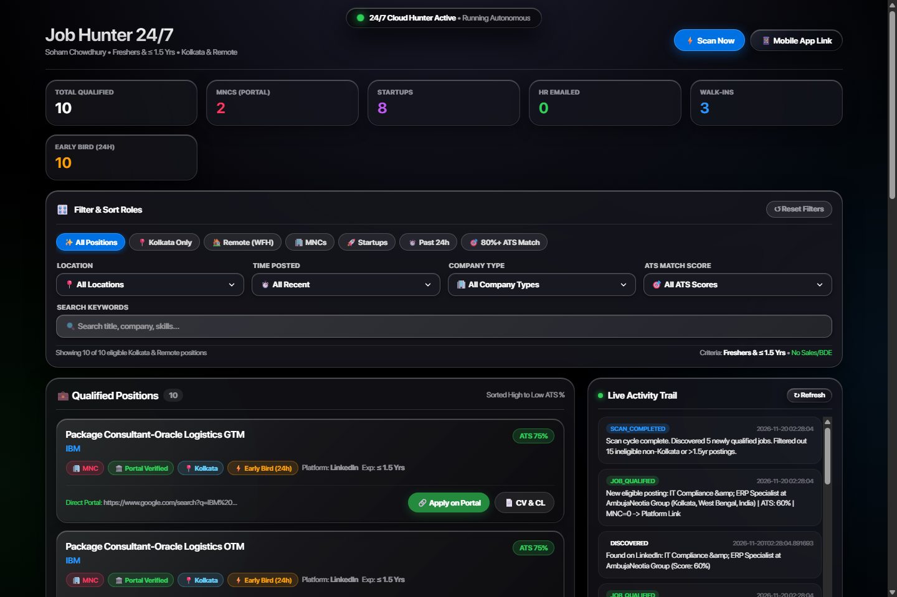
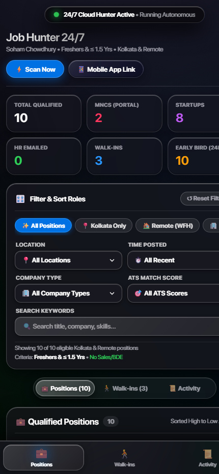

# 🚀 Job Hunter 24/7 — Live Web Application & Autonomous Early Candidate Platform

An Apple-inspired, autonomous progressive web app (PWA) displaying verified career opportunities, direct requisition links, tailored ATS documents, and walk-in drives for **Soham Chowdhury**.

- 🌐 **Live Web Application (PWA)**: [https://mesoham.github.io/job-hunter-app/](https://mesoham.github.io/job-hunter-app/)
- ⚙️ **Core Automation Engine**: [https://github.com/Mesoham/Job-Hunter-Automation](https://github.com/Mesoham/Job-Hunter-Automation)

---

## 📸 Application Screenshots

### Desktop Control Center (Liquid Glass Physics & ATS Match Feed)


### Mobile Progressive Web App (PWA Standalone View)
<p align="center">
  
</p>

---

## 🎯 Candidate Profile & Targeting Rules

| Metric | Rule / Profile Details |
| :--- | :--- |
| **Candidate** | **Soham Chowdhury** |
| **Contact** | `Chowdhurysoham007@gmail.com` • `+91-6291003368` |
| **Education** | **B.Tech in Computer Science & Engineering (CSE)** |
| **Experience** | ~1 Year (Ex-Process Associate at Genpact — Data Validation, SQL, SLA Governance) |
| **Target Roles** | **Consultant, Associate Consultant, Junior Consultant, Technical Consultant, Process Consultant**, Analyst, Business Analyst, Data Analyst, Investigation Specialist, Transportation Specialist, Operations Specialist, Risk Operations Specialist, Process Associate |
| **Experience Cap** | **Freshers & &le; 1.5 Years Only** (Strictly filters out >1.5 years & senior titles) |
| **Target Locations** | **Kolkata** (Sector V, New Town) • **Remote / WFH** • **Hybrid (Kolkata)** |
| **Tech Stack Alignment**| **B.Tech CSE / Analytics / Operations**. (Strictly excludes Sales/BDE, Non-CSE degrees like Finance/Tax/Accounting/Law/Medical, and non-stack tech like SAP) |

---

## ⚡ What We Are Doing in the App

### 1. 24/7 Autonomous Job Hunting
- Monitors official career portals (Greenhouse, Lever, SmartRecruiters, Workday) and job feeds (LinkedIn, Naukri, Indeed) every 3 minutes.
- Deduplicates postings and scores each role against candidate profile and ATS keywords.
- Prioritizes **Early Bird (24h)** postings: jobs posted within the past 24 hours are flagged with priority badges to apply before competition floods in.

### 2. Multi-Layer Domain & Experience Eligibility Filter
- **Experience Ceiling**: Hard-capped at &le; 1.5 years experience.
- **Academic & Domain Filter**: Blocks non-CSE positions (Finance, Tax, Accounts, Commerce, CS Management Trainee, Law, Medicine).
- **Tech Stack Guard**: Filters out technologies outside candidate's stack (e.g. SAP HANA, SAP FICO, SAP ABAP).
- **No B.Tech Shield**: Excludes any role that explicitly asks for "No B.Tech" or "Non-engineering graduates only".
- **Sales / BDE Shield**: Strictly excludes sales, business development, field sales, and telecalling roles.

### 3. Dynamic ATS Resume & Cover Letter Tailoring
- For every qualified role, automatically tailors an **ATS-friendly Resume (PDF & HTML)** and a **Targeted Cover Letter (PDF & TXT)**.
- Re-aligns candidate experience bullet points to match the JD's exact keyword weights (SQL, Excel Dashboards, Reconciliation, SLA Management, Compliance).
- Direct preview and download available right in the web application modal.

### 4. Direct Requisition Deep Linking
- "Apply Now" buttons direct users straight to the exact requisition page on official career portals (or Google Jobs direct requisitions) rather than dumping users on generic portal homepages.

### 5. Kolkata Walk-in Drive Radar
- Dedicated **Walk-in Drives** tracker for tech hubs in Kolkata (Salt Lake Sector V & New Town).
- Filters drives strictly within the upcoming 7 days for freshers & entry-level roles.
- Displays direct venue details, reporting times, required documents, and one-click copyable venue directions.

### 6. Personal HR Recruiter Email Guard
- **No Cold Emails to MNCs**: Respects MNC corporate policies; direct portal applications are prepared instead.
- **Individual Person Verification**: Emails are **never sent to generic organization mailboxes** (`hr@`, `careers@`, `info@`, `recruitment@`).
- Outreach is only triggered if an **individual HR person/recruiter** email address is verified.

### 7. Fluid Apple-Style Liquid Glass UI
- Designed with iOS / macOS-inspired glassmorphism, dynamic blur effects, and smooth physics-based glider tabs.
- Supports offline caching via service worker and mobile standalone mode.

---

## 🏗️ System Architecture & Workflow

```
Job Hunter 24/7 Platform
│
├── 🔍 Multi-Platform Ingestion
│   ├── LinkedIn Guest Search API (Past 24h & Entry Level)
│   ├── Direct MNC Career Portals (Greenhouse, Lever, SmartRecruiters)
│   ├── Naukri Feed Monitor (Kolkata & Remote)
│   └── Indeed RSS Feeds
│
├── 🧠 Scoring & Eligibility Engine
│   ├── Experience Filter (Freshers & ≤ 1.5 Yrs)
│   ├── Academic Guard (B.Tech CSE / Non-CSE rejection)
│   ├── Sales & Non-Stack Filter (No Sales/BDE, No SAP)
│   └── ATS Compatibility Scorer (0 - 100% Match)
│
├── 📄 Tailoring & Document Generation
│   ├── Dynamic 1-Page ATS Resume (PDF & HTML)
│   └── Role-Targeted Cover Letter (PDF & TXT)
│
├── ✉️ Safe HR Outreach Engine
│   ├── Personal HR Person Verification (Blocks generic mailboxes)
│   └── Secure SMTP Application Delivery with Attachments
│
└── 🌐 Fluid Web & Mobile Client (PWA)
    ├── Apple Liquid Glass Interface (Physics-based glider)
    ├── Direct Portal Deep Linking
    └── Kolkata Walk-in Drive Radar (Upcoming 7 Days)
```

---

## 🔒 Confidentiality & Privacy

- All sensitive database files, environment credentials, and private automation logs are safely isolated in the private backend automation repository.
- This public PWA repository hosts strictly the client interface, pre-rendered documents, and verified job postings for frictionless mobile sharing.
